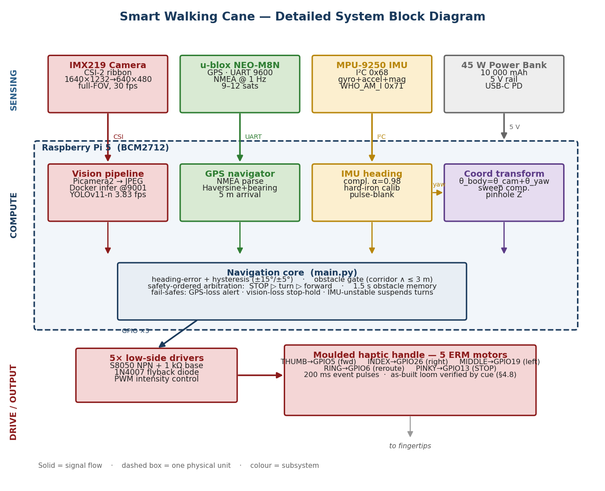
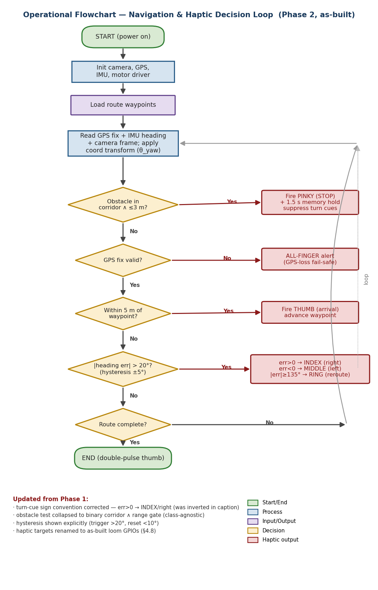
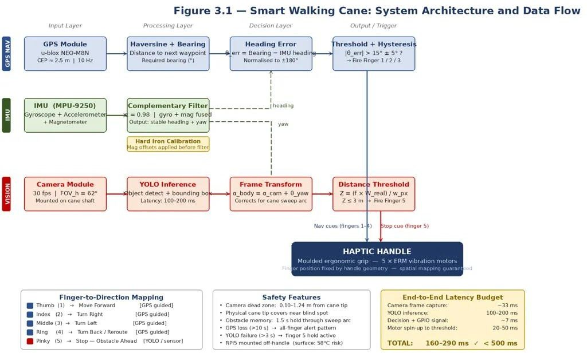
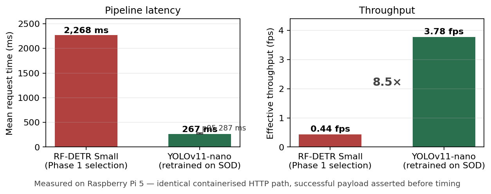
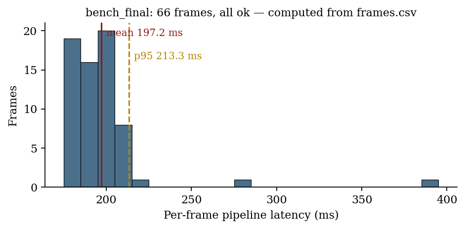
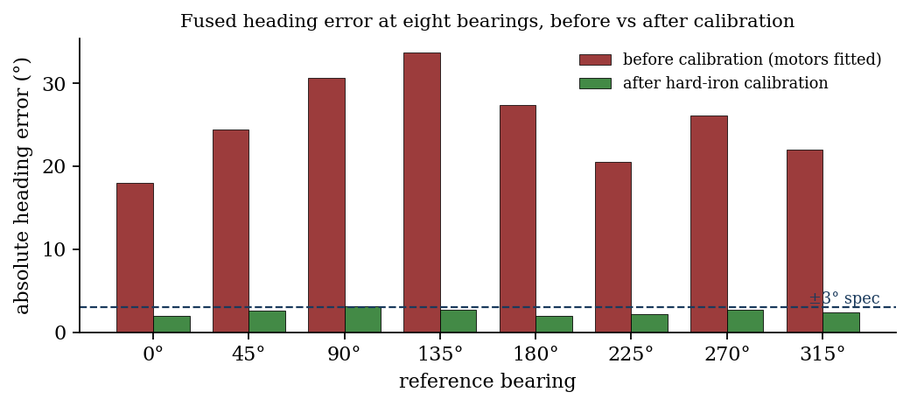
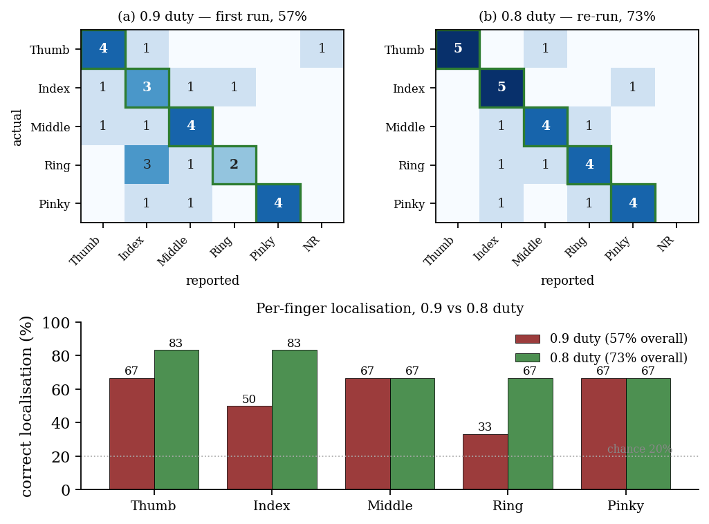
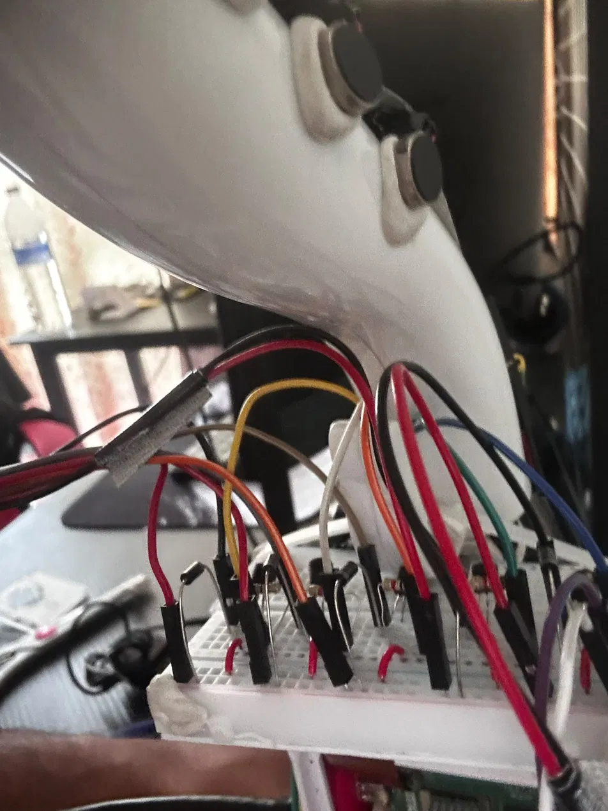
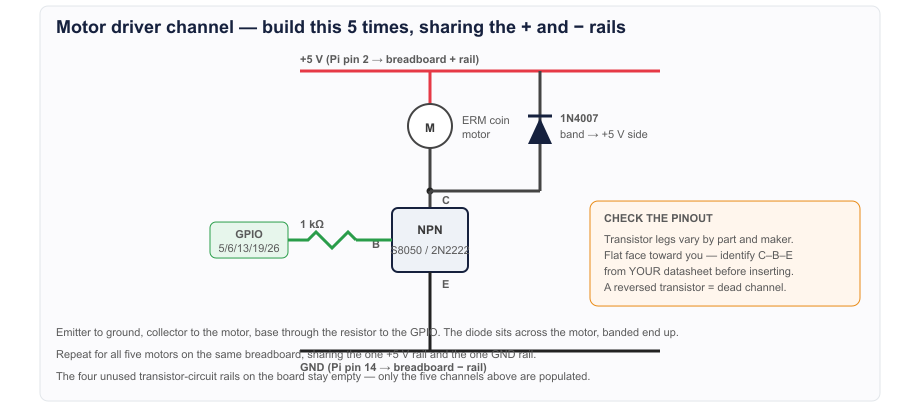

# Smart Walking Cane — Vision-Guided Haptic Navigation Aid

**Final Year Project · BEng (Hons) Mechatronic Engineering · Asia Pacific University · 2026**

An assistive cane for visually impaired users that **sees obstacles, knows where it is, and tells the user which way to go through their fingers** instead of through audio. A Raspberry Pi 5 fuses an on-device object detector, GPS and an IMU, then drives five vibration motors moulded into the handle — one per finger — so *the finger that vibrates is the direction*.

## Results at a glance

| Metric | Result |
|---|---|
| Vision latency in the field | **202 ms mean / 229 ms p95** over 1,774 live outdoor frames (budget: 500 ms) |
| Detector speed-up | RF-DETR Small 2,268 ms → retrained **YOLOv11-nano 267 ms** per frame (**8.5×**) |
| Obstacle stop cue | **87 cues** over three outdoor walk tests, **every one inside the 1.34–3 m safety window** (mean 1.65 m) |
| Heading accuracy | Within **±3°** at all eight bearings after hard-iron calibration (25–35° error before) |
| Haptic recognition | Per-finger localisation raised from **57% → 73%** (chance = 20%) by retuning motor duty cycle |
| Off-axis rejection | Corridor gate rejected **41/41** off-axis detections; stop logic stayed correct across 238 out-of-distribution detections |

## How it works

| Finger | Cue |
|---|---|
| Thumb | Forward / waypoint reached |
| Index | Turn right |
| Middle | Turn left |
| Ring | Turn back |
| Little finger | **STOP — obstacle in path** |
| All five, 3 pulses | GPS lost |

The control loop runs at **10 Hz** with a **safety-ordered arbitration ladder**: an obstacle stop always overrides navigation, GPS loss overrides turn cues, and turn cues use hysteresis (trigger 20°, release 10°) so they don't chatter.

### Subsystems

- **Vision** — IMX219 camera via Picamera2 → JPEG → on-device Roboflow inference server in Docker (fully offline). YOLOv11-nano retrained on the SOD street-obstacle dataset (10,000 images, 22 classes). Detections are gated by confidence (0.35), a sweep-corrected forward corridor, and ground range from pinhole geometry (`d = h / tan δ`).
- **Positioning** — u-blox NEO-M8N over UART, NMEA parsing, Haversine distance and bearing to surveyed waypoints, 5 m arrival radius.
- **Heading** — complementary filter (α = 0.98) fusing gyro rate with tilt-compensated magnetometer heading, with magnetometer blanking while motors pulse (motor magnets corrupt the reading).
- **Haptics** — 5 ERM motors on S8050 NPN low-side drivers with flyback diodes, 200 ms event pulses and a 500 ms per-finger refractory period.
- **Sweep compensation** — the cane sweeps ±30° in use, so detections are transformed into the body frame (`θ_body = θ_cam + θ_yaw`) and held for 1.5 s across sweep gaps.

## Engineering problems I root-caused

1. **Silent camera crop.** Picamera2 picked a 640×480 centre crop of the 3280×2464 sensor, shrinking the field of view to ~12° instead of 62°. Every range calculation was wrong but *looked* right. Found by eye, fixed by pinning the raw stream to the full-array binned mode and letting the ISP downscale, with a startup check so it can't regress.
2. **Counterfeit IMUs.** Two "MPU-9250" boards returned `WHO_AM_I = 0x70` (an MPU-6500 die with no magnetometer). Made the register read a goods-in acceptance test and fixed it at the architecture level with a discrete QMC5883L magnetometer.
3. **Detector too slow.** The first model (RF-DETR) ran at 0.44 fps on the Pi. Retrained a nano-scale YOLOv11 and benchmarked both through the identical HTTP path.
4. **Inference server wouldn't start.** The ARM-specific Docker image shipped without a dependency (`starlette`) in every tag; switched to the multi-arch image.

| Latency: before vs after | Field latency distribution |
|---|---|
|  |  |

| Heading error before/after calibration | Per-finger perception (confusion matrices) |
|---|---|
|  |  |

## Hardware

| Build | Motor driver channel |
|---|---|
|  |  |

Raspberry Pi 5 · IMX219 camera (CSI-2) · u-blox NEO-M8N GPS (UART) · MPU-6500 + QMC5883L (I²C) · 5× ERM motors · S8050 NPN drivers · 10,000 mAh USB-C PD power bank · hand-moulded handle

GPIO map: see [`images/gpio-pinout.png`](images/gpio-pinout.png). Detector per-class accuracy: [`images/per-class-ap.png`](images/per-class-ap.png).

## Tech stack

Python · Raspberry Pi 5 · Picamera2 · OpenCV · YOLOv11 · Roboflow Inference (Docker) · pyserial / NMEA · smbus2 (I²C) · gpiozero · NumPy / pandas / Matplotlib for analysis

## Code

The core decision logic is summarised in [`src/core_logic.md`](src/core_logic.md) (abbreviated listings from the report). Modules:

| File | Role |
|---|---|
| `main.py` | Orchestrator and 10 Hz arbitration loop, per-tick CSV logging |
| `gps_navigator.py` | Haversine, bearing, heading error with hysteresis, arrival/turn-back state machine |
| `imu_filter.py` | Complementary filter and motor-pulse blanking |
| `yolo_detector.py` | Inference client, corridor and range gating, calibration and evidence-capture tooling |
| `haptic_output.py` | Finger-allocated motor driver with refractory period and alert pattern |
